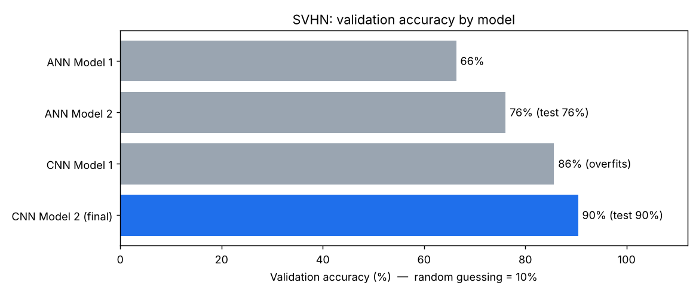
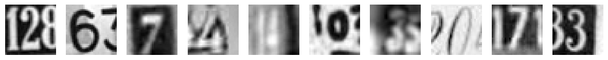
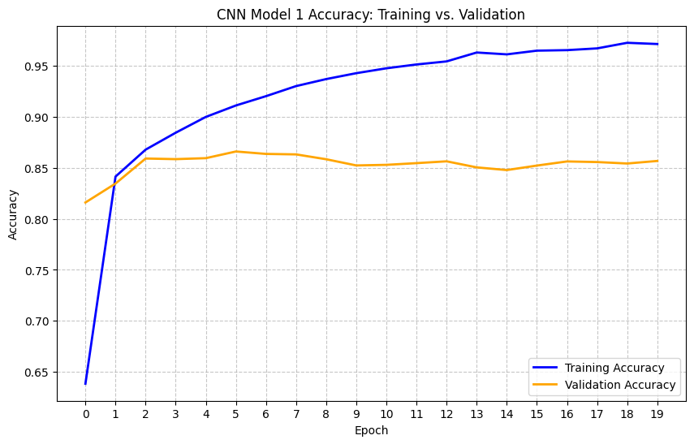
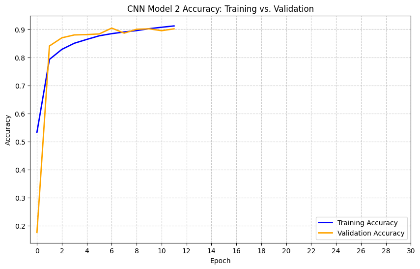
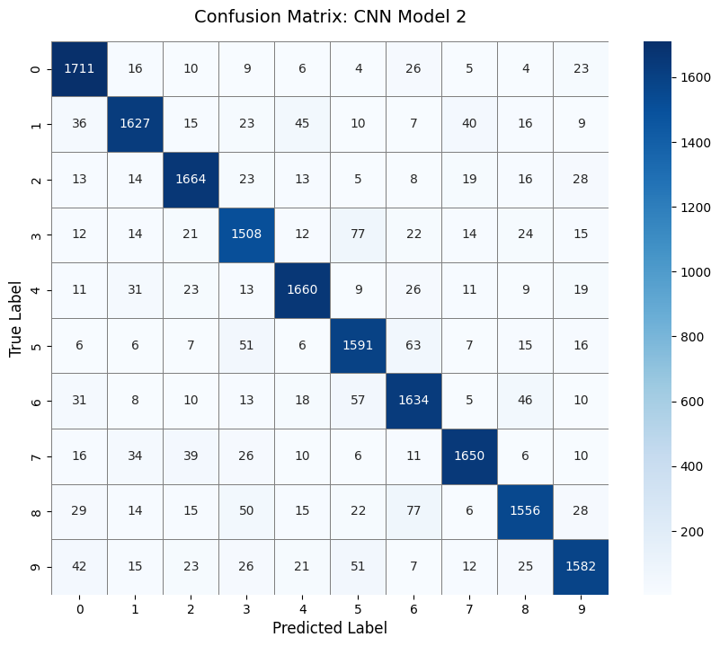

# Street View House Number (SVHN) Digit Recognition

Deep learning project for the **MIT Applied AI & Data Science Program**: classifying digits (0–9) cropped from real street-level photos and comparing fully connected neural networks (ANNs) with convolutional neural networks (CNNs).

**Best model:** a regularised 4-layer CNN with **90% test accuracy** on 18,000 unseen images, compared with 76% for the best ANN.



---

## Problem

The SVHN dataset has over 600,000 digits cropped from street-view images. It was used by Google to transcribe house numbers automatically and improve map accuracy. Unlike MNIST, these are natural scenes: lighting, scale and blur vary, and neighbouring digits often intrude into the crop. The objective is to predict the digit in each image and find out empirically whether an ANN or a CNN is the right tool.

## Dataset

A preprocessed subset supplied as an `.h5` file: **42,000 training** and **18,000 test** images, each 32×32 grayscale, across ten balanced classes.

> The dataset was provided through the program and is **not included** here (it is ~490 MB). See [`data/README.md`](data/README.md).



## Approach

All models use Adam, categorical cross-entropy, a 20% validation split and fixed random seeds. Pixels are scaled to 0–1 and labels are one-hot encoded.

| Model | Architecture | Params | Training |
| --- | --- | ---: | --- |
| ANN 1 | Dense 64 → 32 → 10 | 68K | 20 epochs, LR 1e-3 |
| ANN 2 | Dense 256 → 128 → Dropout(0.2) → 64 → 64 → 32 → BatchNorm → 10 | 310K | 30 epochs, LR 5e-4 |
| CNN 1 | Conv16 → Conv32 → MaxPool → Dense32 → 10 (LeakyReLU 0.1) | 267K | 20 epochs, batch 32 |
| **CNN 2** | **[Conv16 → Conv32 → Pool → BN] → [Conv32 → Conv64 → Pool → BN] → Dense32 → Dropout(0.5) → 10** | **164K** | **≤30 epochs + early stopping (patience 5)** |

## Results

| Model | Validation accuracy | Test accuracy | Macro F1 |
| --- | ---: | ---: | ---: |
| ANN 1 | 66% | — | — |
| ANN 2 | 76% | 76% | 0.76 |
| CNN 1 | 86% (peak 87%) | — | — |
| **CNN 2** | **90%** | **90%** | **0.90** |

**Overfitting vs. regularisation.** CNN 1 learns quickly but overfits: training accuracy climbs to 97% while validation accuracy stalls around 86%, and validation loss nearly doubles after epoch 4. CNN 2 adds BatchNorm, Dropout and early stopping, which keeps the two curves together. Training stopped at epoch 12 and rolled back to the best weights from epoch 7.

<p align="center">
  
  
</p>

<p align="center">
  
</p>

### Key takeaways

- **CNNs beat ANNs by about 14 points.** Flattening a 32×32 image into a 1,024-element vector throws away the spatial layout. Convolutions keep it and learn edges and strokes directly.
- **More parameters don't mean a better model.** The final CNN has the fewest parameters of the three larger models and is the most accurate.
- **Regularisation was the deciding factor.** The architecture alone (CNN 1) reached about 86%. BatchNorm, Dropout and early stopping lifted it to 90% and removed the overfitting.
- **Hardest digits:** 3 (F1 0.87) and 8 (recall 0.86), which share curved strokes with 5, 6 and 9.

### Next steps

- Data augmentation (small shifts, rotations and contrast changes).
- A third convolutional block and learning-rate scheduling.
- Test on the full multi-digit SVHN format.

## Repository structure

```
.
├── notebooks/
│   └── SVHN_Digit_Recognition.ipynb   # full, commented notebook with original outputs
├── reports/
│   └── SVHN_Digit_Recognition.html    # HTML export of the submitted notebook
├── images/                            # figures used in this README
├── data/
│   └── README.md                      # where to put the dataset
├── requirements.txt
└── README.md
```

## How to run

**Google Colab (recommended, GPU):** upload `SVHN_single_grey1.h5` to Google Drive, open the notebook in Colab, set `DATA_PATH` in the first code cell, then *Runtime → Run all*.

**Locally:**

```bash
python -m venv .venv && source .venv/bin/activate
pip install -r requirements.txt
# put SVHN_single_grey1.h5 in data/
jupyter notebook notebooks/SVHN_Digit_Recognition.ipynb
```

## Tech stack

Python · TensorFlow / Keras · scikit-learn · NumPy · h5py · Matplotlib · Seaborn · Google Colab

---

*Sauraj Karki, MIT Applied AI & Data Science Program*
